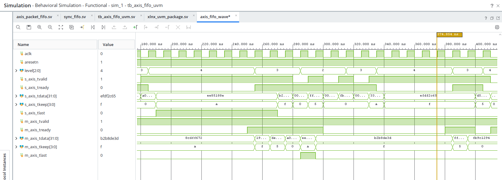

# AXI4-Stream FIFO UVM evidence

## Simulation result

```text
PASS: 64 beats checked; full cycles=105; source stalls=97; sink stalls=139; TKEEP/TLAST covered
UVM_WARNING: 0
UVM_ERROR:   0
UVM_FATAL:   0
Simulation completed at 2115 ns
```

## Waveform

Vivado Simulator 2026.1 waveform, zoomed to approximately 180–400 ns. The output channel shows `m_axis_tvalid` asserted while `m_axis_tready` is low; the output payload remains stable during that stall and advances after the receiver is ready. The view also includes reset, FIFO level, and both stream interfaces.



The waveform is supporting evidence. The UVM scoreboard PASS is the check that all 64 accepted output beats matched the accepted input beats in `TDATA`, `TKEEP`, and `TLAST`.
